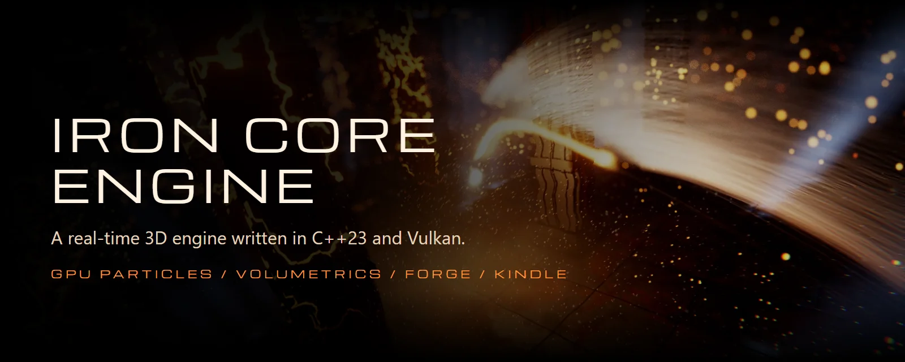
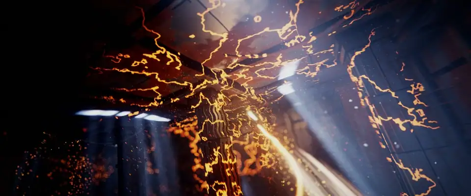
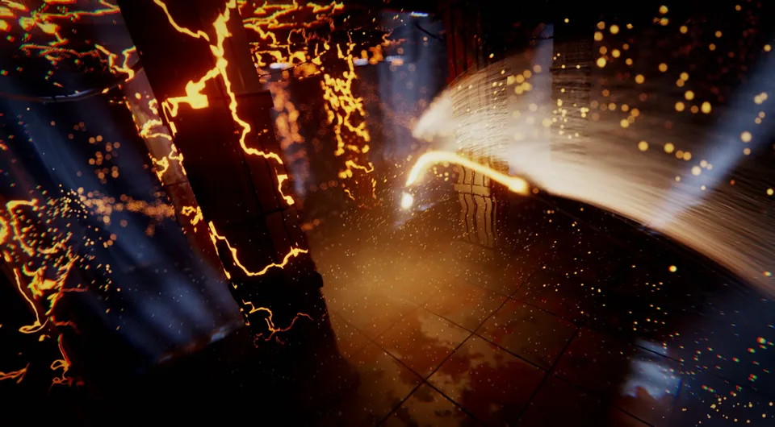
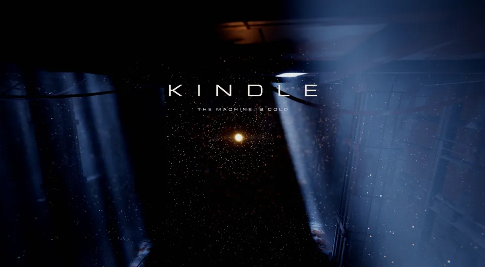
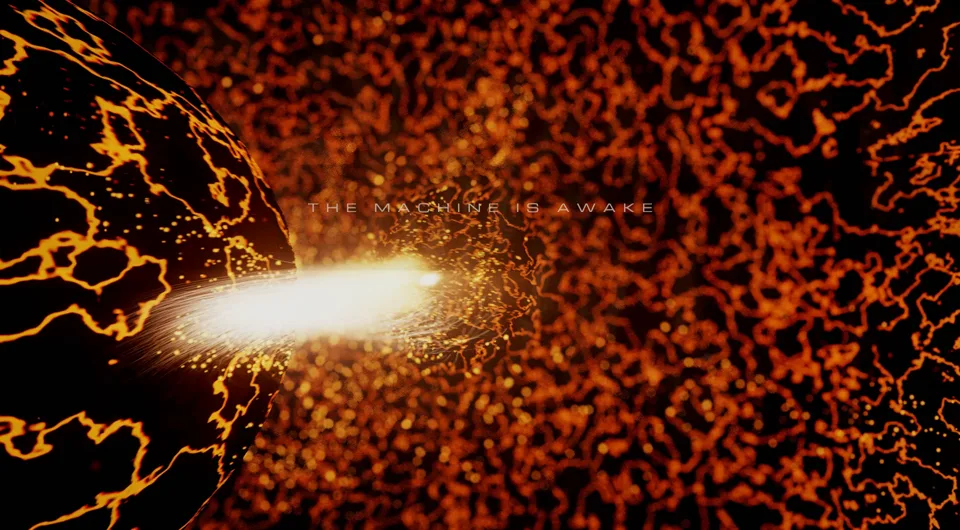
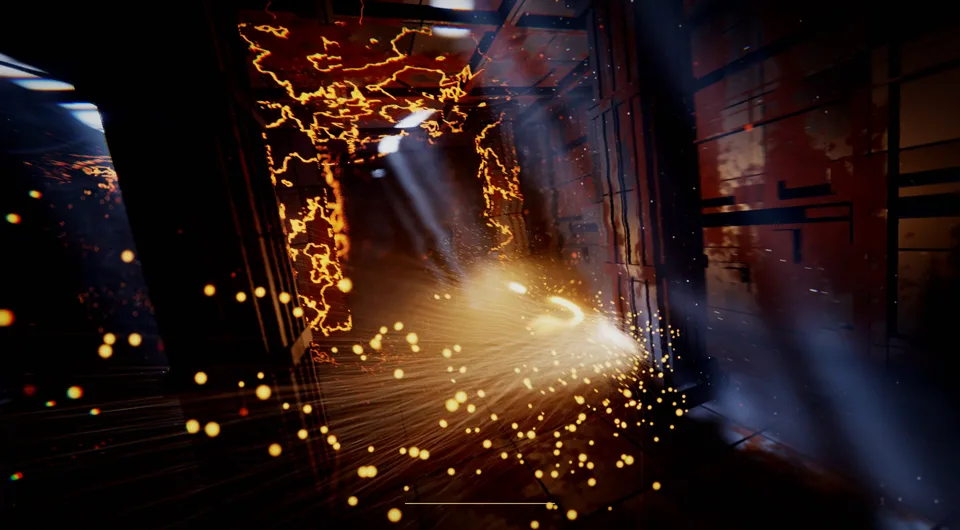
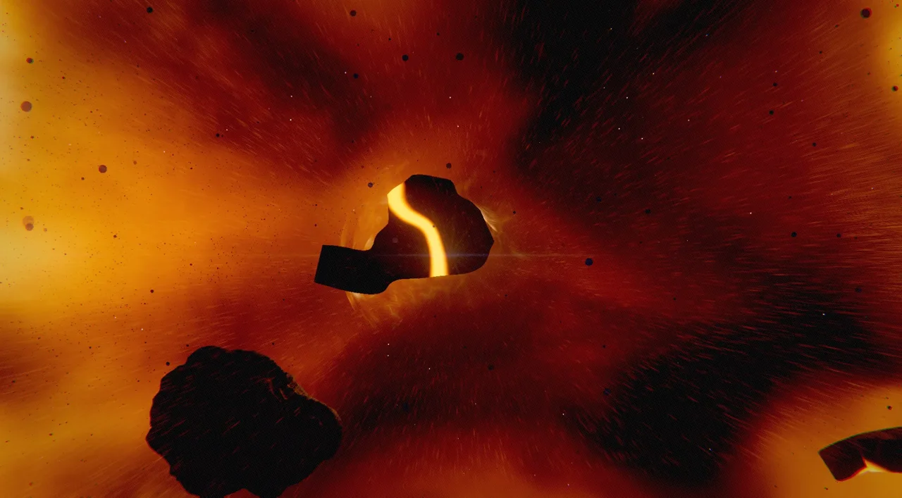
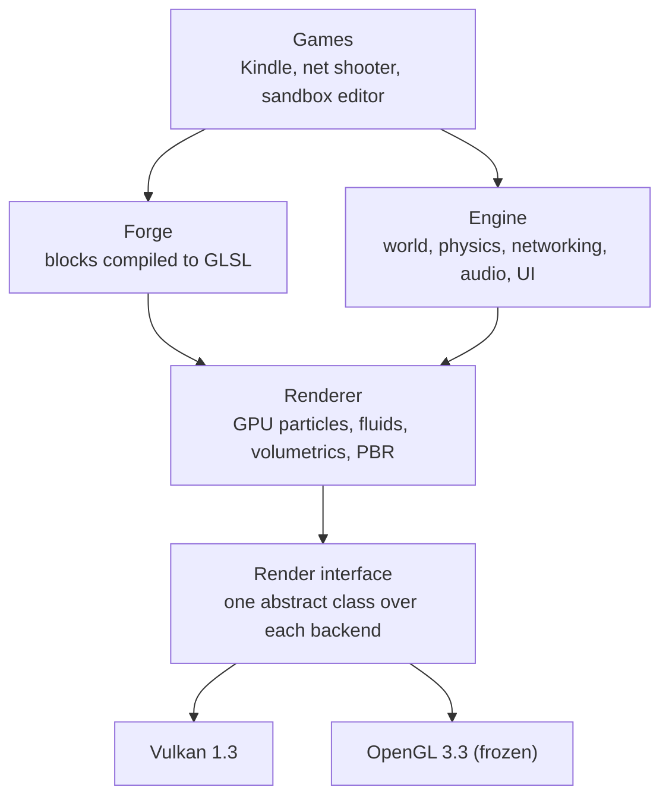

<p align="center">
  
</p>

<p align="center">
  <a href="https://kindle-download.streafe.workers.dev/"></a>
  <a href="https://hanken.dev"></a>
</p>

<p align="center">
  
  
  
  <a href="LICENSE"></a>
  <a href="https://github.com/EliasHanken/iron-core-engine/actions/workflows/ci.yml"></a>
</p>

Iron Core is a 3D game engine I wrote from scratch: the math, the render pipeline, the architecture and the tools. It has about 73,000 lines of C++, 19 demos and 99 test programs. It's a personal project, and everything on this page runs in real time on the engine.

## Kindle

<p align="center">
  
</p>

**A short game where the particles are the player.** You are a swarm of 800,000 sparks in a dead machine. Ignite, and veins of fire spread through the iron and stay lit. Squeeze through the gate, feed the dormant core, and the whole machine wakes.

**[Download Kindle for Windows](https://kindle-download.streafe.workers.dev/)**: 92 MB, on Windows 10 or 11 with a Vulkan 1.3 graphics card. Windows may warn about an unknown app, because the game isn't code-signed.

| | |
|---|---|
|  |  |
|  |  |

- **One world, two processors:** the hall is plain math, in C++ and in GLSL. The player on the CPU and every spark on the GPU collide with the same world, with no readback.
- **Fog you can move:** a real fluid simulation that the swarm stirs and bursts blow apart.
- **Light with direction:** pillars shadow the swarm's light through the air and onto the walls, while cold shafts fall from cracks in the roof.
- **A camera with a body:** depth of field that keeps the swarm sharp, heat haze, slow motion on the core's blast, and a lens that reacts to bursts.
- **Quality that scales the content:** four levels change the same effect file, with light compensated so the picture holds its brightness.
- **A real mix:** per-room reverb, ducking, pitch variation and a recorded score.

## Forge

<p align="center">
  
</p>

**Effects and shaders built from plain blocks, with no GLSL.** An effect is a small JSON file that compiles to GPU code. Particle values live in a uniform buffer rather than in the shader, so sliders change a running effect without a recompile.

```json
{
  "forge": 1,
  "target": "particles",
  "count": 200000,
  "spawn": [{"block": "Point", "spread": 0.2},
            {"block": "Launch", "speed": 7, "spread": 0.8}],
  "move": [{"block": "Gravity"}, {"block": "Drag", "amount": 0.7}],
  "look": [{"block": "ColorOverLife"},
           {"block": "Size", "size": 0.012},
           {"block": "Fade"},
           {"block": "Glow", "intensity": 0.2}]
}
```

A running game can feed an effect each frame, like exposed properties in a VFX graph:

```cpp
player.setInput("leader", swarm.position());
player.setInput("blast", {swarm.blast(), 0, 0});
```

Mistakes come back with a fix, which also makes Forge easy for an AI to write. The aurora above was written that way, using the `forge` command-line tool to read the catalog, check the file and render stills.

```json
{"where": "layers.0.move.0", "code": "unknown-block",
 "message": "There is no block called \"CurlFlw\".", "fix": "Did you mean \"CurlFlow\"?"}
```

Read more in the [Forge guide](docs/forge/README.md), or open `forge-studio` to edit effects live.

## The film

<p align="center">
  
</p>

A 30-second shot running in the engine. A dead planet core cracks open, and the shockwave moves through a GPU fluid simulation drawn as true volumetrics, lit by the effect itself. See it at [hanken.dev](https://hanken.dev).

## How it fits together



## What's in the engine

| Area | Highlights |
|---|---|
| **Rendering** | PBR, image-based lighting, bloom, SSAO, reflection probes, parallax and tessellated displacement, skeletal animation |
| **VFX** | Programmable GPU particles and ribbons, a GPU fluid solver, volumetric raymarching, a 3D light grid filled by particles |
| **Camera** | Motion blur, depth of field, heat haze, chromatic aberration, anamorphic streaks, film grain and grading |
| **Tools** | An ImGui editor with gizmos, inspectors, prefabs, undo and a node graph, plus Forge Studio |
| **World** | Components with reflection, scene and prefab serialization, hot reload |
| **Physics** | Jolt rigid bodies, character controllers, ragdolls and Verlet ropes |
| **Networking** | Replication, client prediction and lag compensation over GameNetworkingSockets |
| **Audio** | OpenAL with reverb, filtering and 3D sound |

## Demos

| Demo | What it shows |
|---|---|
| [`19-kindle`](games/19-kindle) | The game above |
| [`18-forge-studio`](games/18-forge-studio) | Live editing of effects and shaders |
| [`17-iron-core`](games/17-iron-core) | The 30-second film |
| [`16-genie`](games/16-genie) | A genie and a vector-field orb |
| [`11-sandbox`](games/11-sandbox) | The scene editor |
| [`07-net-shooter`](games/07-net-shooter) | A multiplayer shooter with hitscan, rockets and ragdolls |

The rest of [`games/`](games) are smaller demos of physics, networking, glTF, UI and more. A few are from the OpenGL era and need `-DIRON_RENDER_BACKEND=opengl`.

## Build it

You need CMake 3.20 or later, a C++23 compiler (MSVC), [vcpkg](https://vcpkg.io), and Python 3 with `jinja2`.

```
cmake -S . -B build -DCMAKE_TOOLCHAIN_FILE=<vcpkg>/scripts/buildsystems/vcpkg.cmake
cmake --build build --config Release --target kindle
```

Run the tests with:

```
cmake --build build --config Debug
ctest --test-dir build -C Debug --output-on-failure
```

A build from this repo runs Kindle with its free CC0 sounds. The download uses licensed recordings and a score, which can't be redistributed here.

## Licence

Iron Core's code is licensed under [Apache-2.0](LICENSE), so you can use, change and ship it, including commercially, as long as you keep the notices. The names and logos aren't included.

Fonts, models, textures, sounds and libraries keep their own terms, which are listed in [THIRD_PARTY.md](THIRD_PARTY.md). One sample model, the Damaged Helmet, is non-commercial only.

## Layout

```
engine/    the "ironcore" library
games/     demos and games that link it
tools/     the forge command-line tool and Kindle's build scripts
tests/     99 test programs
docs/      the Forge guide, engine notes, and design specs
```
